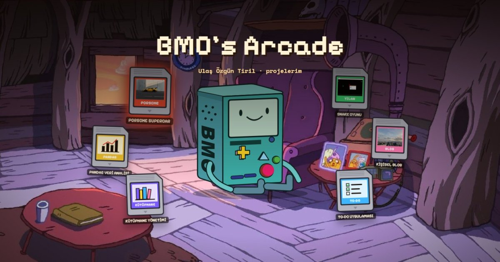

# BMO's Arcade (React + Vite)

A personal portfolio site where each project is a game cartridge. Pick one, insert it into BMO, and the camera zooms onto BMO's screen where the project opens.

**Live site:** https://ulas010.github.io/bmo-arcade/



## Features

- Six projects as cartridges around BMO; hover or use the arrow keys to select one
- Inserting plays a cassette-style animation: the cartridge flies to the slot, slides in, and the camera zooms onto BMO's screen
- Browse projects with Previous / Next without ejecting; eject to zoom back out
- Any insert or eject animation can be skipped with a click, a tap, or Enter
- BMO reacts to you: his eyes follow the selected cartridge, he falls asleep after 10 seconds of inactivity, and gets annoyed if you poke him five times quickly
- Start screen ("PRESS START"), which also unlocks browser audio
- Responsive: on phones the cartridges become a horizontal strip with edge fades that hint at scrolling
- Accessibility: full keyboard control, labelled controls for screen readers, reduced-motion support, checked text contrast
- All sound effects are generated in code; there are no audio files. Mute state is remembered with `localStorage`

## Controls

| Input | Action |
| --- | --- |
| Left / Right arrows | select a cartridge, or switch project when one is open |
| Enter / Space | insert the selected cartridge |
| E / Esc | eject |
| Click or tap while animating | skip the animation |

BMO's buttons work too: the yellow D-pad browses, red inserts, green ejects, the triangle makes him talk, and the two bars toggle sound.

## Tech

- HTML, CSS and plain JavaScript
- React 18 for the components and state, Vite 7 for the dev server and the build
- BMO and the cartridges are drawn in code as SVG; their coordinates come from a 500x500 reference sticker
- Camera zoom with a CSS transform computed from BMO's measured screen position
- Cartridge hand-off between a DOM clone and BMO's own SVG drawing with the Web Animations API and `flushSync`
- Sound effects with the Web Audio API
- Deployed to GitHub Pages with GitHub Actions on every push to `main`

## Why I built it

I wanted to improve my front-end skills and have a portfolio piece that stands out on my CV. Instead of a standard grid of project cards, I built an interactive scene so I could practice animation, state management and accessibility on something I enjoy.

## What I practiced

- **Modelling a UI flow as a state machine:** insert, open and eject run through four phases (`idle`, `inserting`, `open`, `closing`), so input is only accepted when it makes sense. Async animations read refs that mirror state, which avoids stale values.
- **Coordinating the DOM, SVG and animation:** measuring BMO's rendered screen to compute the camera transform, and handing a cloned DOM element over to an SVG drawing without a visible jump.
- **Cancellable animations:** tracking running Web Animations so a click can finish all of them instantly.
- **Drawing in code:** building BMO and the cartridges as SVG from a reference image, with shared geometry constants so the zoom and the insert animation stay aligned with the drawing.
- **Accessibility:** keyboard control for everything, `inert` background while a project is open, focus management, and a screen-reader status region that announces the full sentence instead of the typing effect. A contrast check found a failing button colour on all six projects, which I fixed.
- **Responsive design:** a separate phone layout, with CSS mask fades driven by the strip's scroll position.
- **Shipping:** Git, GitHub Pages with GitHub Actions, and Open Graph tags for link previews.

## Run it

Node.js 20.19 or newer is required.

```bash
npm install
npm run dev       # development server at http://localhost:5173
npm run build     # production build in dist/
```

Projects live in `src/data/projects.js`; add an object there to add a cartridge.

## Notes

BMO and the background room belong to the TV series Adventure Time. This is a non-commercial personal portfolio.

Three project covers (Porsche, Snake, Blog) are loaded from the projects' own GitHub repositories, so they depend on those repositories staying public. The other three (Pandas, Library, To-Do) are small illustrations drawn for the site because those repositories have no screenshot.
